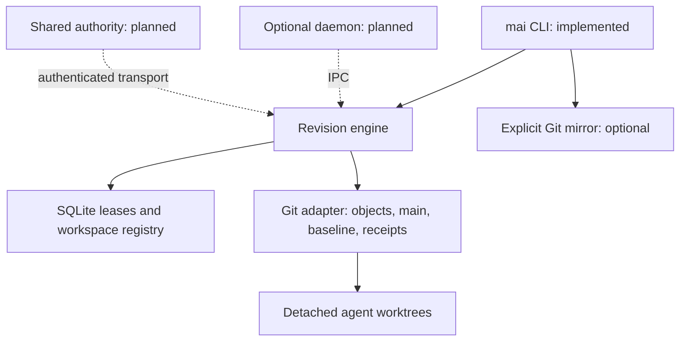

# mai architecture

This is the authoritative design for the Rust 0.0.1 implementation. Public behavior is a centralized revision protocol for agents, with a trusted-local Git adapter today. CI targets Linux, macOS, and Windows; native Windows qualification remains experimental. Targets and implemented capabilities are distinguished below.

## Layers and deployment

One Cargo package keeps boundaries small: `src/core.rs` owns revision, workspace, conflict, lease, and publication semantics; `src/storage_git.rs` owns Git execution, index/object operations, and ref CAS; `src/protocol.rs` owns typed submission receipts; `src/main.rs` owns parsing and presentation. `mai-bench` is a separate native benchmark helper, not a service. The core has no HTTP framework, async runtime, or CLI dependency in its logic. Some existing inspection responses use JSON values; replacing these with versioned DTOs is a prerequisite for a stable network protocol.



The adapter exposes the operations actually needed by this engine. We deliberately retain concrete Git operations rather than a generic storage plugin system; a second backend would justify a trait extracted from proven requirements. The agent interface avoids branches, but workspaces and inspection currently use Git implementation details internally.

## Revision and repository format

`.mai/repo.git` stores objects and the authoritative `refs/heads/main`. `refs/mai/base` fixes r0 forever. Legacy `.agenttrunk/repo.git` and `refs/agenttrunk/base` open without migration. `.mai/metadata.sqlite3` (or the legacy equivalent) retains the Python schema: `leases(path,agent,expires_at)` and `workspaces(agent,created_at)`. WAL plus `BEGIN IMMEDIATE` coordinates publishers and lease writers across local processes. SQLite uses a 20-second busy timeout and FULL synchronous mode.

Each accepted revision is one single-parent commit on main. Its revision is the first-parent distance from the immutable import baseline. Imported history remains Git history and is not assigned negative revisions. Read operations snapshot the head once to keep reported revision/commit pairs consistent; workspace/lease status is not a single cross-system snapshot.

`workspaces/AGENT` is a detached full Git worktree with a private index and working directory sharing the authority's objects. HEAD records the base commit; its revision is derivable from history. Agent names are 1–64 ASCII alphanumeric/underscore/hyphen characters and must begin alphanumerically. No user-managed branch is required. Registry entries expose missing workspaces rather than silently hiding them. Failed worktree creation/registry commits may require administrator reconciliation; automatic registry repair is not implemented.

## Submission pipeline

```mermaid
sequenceDiagram
    participant Agent
    participant Prepare
    participant Gate as SQLite gate
    participant Git
    Agent->>Prepare: workspace, agent, message, optional local check
    Prepare->>Prepare: per-agent lock; stage/hash; snapshot entries
    loop bounded optimistic attempts
        Prepare->>Git: read current head; validate base and path overlap
        Prepare->>Git: build immutable candidate tree and commit
        Prepare->>Gate: BEGIN IMMEDIATE
        Gate->>Git: re-read head
        alt head changed
            Gate-->>Prepare: release and prepare again
        else head unchanged
            Gate->>Gate: revalidate live leases
            Gate->>Git: ref transaction: CAS main and receipt
            Gate-->>Prepare: release
        end
    end
    Prepare->>Agent: accepted receipt; update own workspace outside gate
```

Stage 1 runs independently across agents: explicitly requested `--check`, Git staging/hashing, changed-path collection, index snapshot, ancestor/conflict checks, temporary index construction from current main, and immutable commit creation. Candidate changes are applied to the latest tree, deletions before insertions, retaining every unrelated accepted entry. No patch parsing or automatic text merge occurs.

Stage 2 holds the SQLite write gate only for lease expiration cleanup, head revalidation, active foreign lease checks, and Git CAS. A changed head invalidates the candidate; preparation restarts outside the gate, with bounded small backoff and at most 64 attempts. The current head check revalidates the assumptions used for conflict detection: no accepted commits can enter through supported writers between that check and publication. Git CAS rejects an external writer rather than overwriting it. Temporary index construction and workspace reset are outside the gate. The gate still invokes Git subprocesses and SQLite may queue for 20 seconds, so it is not yet a constant-time high-fanout authority.

Per-agent native file locks (fs2: Unix flock / Windows LockFileEx) under `control/locks/` cover staging, diff, refresh, and submission, preventing duplicate same-workspace operations across Rust clients. Ordinary editing is not locked; callers must quiesce their workspace during submission. These locks survive process coordination, not machine boundaries. Old Python clients do not participate.

Stage 3 is a future durable outbox for derived indexes, notifications, telemetry, and mirroring. Today no asynchronous downstream queue is implemented. `github-sync` is a separate synchronous command that pushes the captured accepted commit without force; a remote outage cannot roll back local history. It can safely be rerun, but remote divergence needs explicit reconciliation.

## Conflicts, leases, and provenance

Changed paths are the staged base-to-candidate difference with renames disabled. Upstream conflicts use base-to-current changes. Equality and component ancestry overlap; `src` conflicts with `src/file`, but not `src-utils`. This intentionally rejects independent edits in the same file and directory/file collisions. Renames are deletion/addition; binary contents, symlink blobs, deletions, and executable modes use Git index semantics. Net upstream differences are compared, matching the prototype; a change later reverted to baseline is not retained as a conflict event.

Leases are exact stored relative paths with optional trailing slash normalized away. Empty components, traversal, absolute paths, backslashes, and NUL fail validation. Foreign overlapping reservations reject both new reservations and publication. Own reservations can renew; expiration uses wall-clock seconds and is checked at publication validation time. TTL ranges 1–86400 seconds; release is exact, not recursive. There is no distributed fencing token. Editing remains advisory; enforcement occurs through supported publication operations, not OS permissions.

Each commit declares `agent/AGENT`, `AGENT@mai.invalid`, `Agent-ID`, and `Workspace-Base`. Authoritative trailers appended by the engine take precedence over similarly named message lines. Task IDs and request IDs are not stored yet; a future protocol should add minimal optional provenance and idempotency keys without collecting prompts or secrets. These identities are not authentication.

## Durability and recovery

Git objects are written before publication. Git runs with `core.fsync=committed` and `core.fsyncMethod=fsync` (Git 2.36+). The authoritative acceptance fact is reachability on main's first-parent history. There is no SQLite revision counter or duplicated SQL revision ledger to reconcile. The publication ref transaction compares old main and updates an auxiliary `refs/mai/receipts/AGENT` acceptance pointer; SQL lease cleanup can roll back after acceptance without erasing a revision.

Git and SQLite do not share a transaction. Git's multi-ref transaction coordinates normal concurrent writers, but loose-ref replacements are not a filesystem-wide atomic crash transaction. Receipts are never treated as authoritative without checking main ancestry. Recovery falls back to first-parent history and matching authoritative agent/base trailers if a receipt is absent. A receipt-only update off main is not acceptance. Objects abandoned before CAS are unreachable and can eventually be garbage collected.

After acceptance, a failed workspace reset returns `workspace_updated:false`. If the process terminates before reset, repeating submit from the same base returns the accepted revision with `recovered:true, workspace_updated:false`; it neither publishes twice nor resets later edits. Recovery tests simulate these intermediate states, including missing and unpublished receipts, and terminate a real CLI process after publication and before reset. They are not power-loss certification.

Recovery procedure: inspect `history` and `show` to identify accepted content; copy any draft or later edits to a safe location outside the workspace; review `diff`; then explicitly `refresh --discard` only after deciding to discard/reapply the preserved draft. Verify the resulting workspace against HEAD before resuming. A clean stale workspace may use ordinary refresh. Do not interpret a recovered response as permission to destroy files.

Limitations: initialization and workspace registration span filesystem and SQLite boundaries and are not fully recoverable transactions; interruptions may leave incomplete initialization or an unregistered worktree. Workspace reset is not transactional and a partly completed reset needs manual review. Filesystem corruption, disk exhaustion, power loss, Git maintenance, and unusual filesystems need qualification before production adoption. Submission receipts are a local recovery aid, not a versioned exactly-once remote request protocol. Backups must include Git, metadata, and important drafts; test restoration independently.

## Security and services roadmap

The current trust model is one local host with native filesystem locks and trusted agents/admins. Workspaces are not sandboxes. Git hooks use the platform null-device path; canonical Windows verbatim drive/UNC paths are converted to Git-compatible spelling before storage initialization. Top-level workspace and registry symlinks are rejected and Git common-directory identity is checked; tracked symlinks remain blobs and Git does not follow them as submitted content. Path traversal inputs are rejected. Git hooks, filesystem monitor hooks, external diff, and textconv are disabled for relevant operations. Trusted Git configuration may still contain filters or transport helpers; this is not a hardened hostile-repository execution environment. `--check` deliberately executes the supplied local shell snippet (`sh -c` on Unix, `cmd.exe /D /S /C` on Windows) and captures output. Do not expose secrets through check output.

No service binds any network interface today. A future optional daemon should use a permission-restricted Unix socket, explicit discovery/start controls, bounded worker pools, persistent registry/cache state, and graceful shutdown. CLI-only operation must remain available. Cross-platform IPC requires separate qualification. The daemon must not weaken multi-process correctness if bypassed.

A future shared server needs authenticated identities, repository/path authorization, fencing or equivalent stale-holder protection, request size and resource limits, bounded admission queues, durable idempotency, auditable outcomes, cancellation, and crash recovery. Bind loopback by default; require explicit configuration for remote interfaces and authentication. Do not accept client-supplied scripts for execution. Keep transport handlers thin and the engine independent of HTTP; run expensive Git/filesystem/CPU operations on bounded blocking pools rather than async executor threads. These requirements are plans, not deployed functionality.

## Performance constraints and choices

Moving coordination from Python to Rust alone cannot remove repeated Git processes, directory scans, full checkout costs, or serialized publication. This implementation changes lock scope as well as language, but retries can rebuild trees/commits repeatedly under burst contention. Worktree creation still holds the registry gate and materializes full trees. Revision counting and recovery history scans grow with history. No benchmark establishes thousand-agent capacity.

Clap provides CLI parsing; rusqlite retains exact existing SQLite formats and bundled deployment; serde/base64 preserve machine responses; fs2 provides native local process locking; tempfile cleans temporary indexes. Git subprocesses retain mature worktree/index/fetch/push behavior. Native gitoxide is a future measured optimization, not a migration prerequisite. Tokio, tracing, Axum, and a custom content database are deferred until a tested service/observability use case exists. Current dependency API review used [Clap documentation](https://docs.rs/clap/latest/clap/), [rusqlite transactions](https://docs.rs/rusqlite/latest/rusqlite/struct.Transaction.html), and [gitoxide documentation](https://docs.rs/gix/latest/gix/); build verification applies to the exact Cargo.lock versions, not every future release.

Rejected alternatives and rationale are in [ADR 0001](docs/adr/0001-foundation.md). Next: qualify interruption/backup recovery, instrument real Git costs, design a versioned protocol and daemon slice, then a secure single-node shared server. Distributed consensus and custom storage are not initial requirements.
