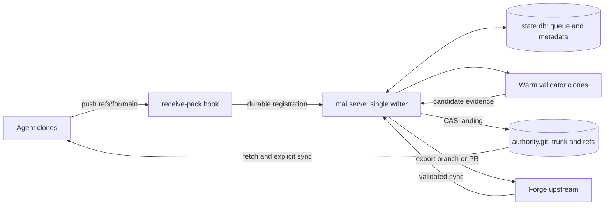

# mai architecture

Status: decided rewrite direction, unimplemented. The existing 0.0.1 binary still uses linked worktrees, workspace-only checks and a SQLite publication gate; see [current CLI precautions](cli.md). M0 qualification and ADR acceptance precede any product-code replacement. [Philosophy](philosophy.md) motivates recovery speed with a strong trunk gate; [ADR 0003](adr/0003-git-native-integration-queue.md) defines the design and open decisions.

## Data and ownership

Agents use ordinary independent Git clones; mai never shares their mutable branch refs. Host transport is file Git; M1b adds loopback smart HTTP with per-agent tokens. A thin proc-receive client registers changes with one long-running engine per authority. The engine owns trunk, immutable submission refs, candidate refs, notes and upstream bookkeeping. Agents may submit virtual refs/for/* or update their own refs/drafts/<agent>. File transport identity is declared, not authenticated; filesystem owners can bypass hooks.

Git's first-parent trunk is the acceptance ledger, with r0 as import baseline. Landed changes are squash commits; validated upstream syncs alone introduce merge commits with trunk as first parent. Mai-Revision trailers assign rN. SQLite WAL stores queue, dependencies, validations, leases and intents; unsupported schema versions refuse startup. Git and SQLite are not one transaction.

## Pipeline

1. Enforce receive limits, identity/namespace policy and idempotency; retain submitted objects before acknowledging registration. Success means received, not landed. Typed states include queued, blocked, awaiting_approval, validating and exactly one terminal outcome per submission version.
2. Resolve dependencies from pushed ancestry. Build candidates using Git merge-base and merge-tree with an explicit base. Map a pending parent's submitted commit to its landed squash; rejection/supersession invalidates descendant candidates. Merge policy defaults await qualification/maintainer confirmation: textual needs a gate, otherwise use path rejection.
3. Warm validator clones run configured regeneration then the gate on the final immutable tree. Pin policy and executable check inputs to approved trunk; protected changes require approval. Pipeline candidates accumulate preceding changes; failures discard/rebuild descendants. Landing requires matching tree, parent and configuration evidence. Explicit batch mode records weaker batch-tip coverage for intermediate revisions.
4. The single writer rechecks policy/leases and CAS-publishes the validated commit, records notes and reconciles queue state. Sync fetches and safely replays only commits after the submitted commit; it never silently overwrites dirty/untracked work.

## Failure and recovery

An exclusive authority lock prevents duplicate engines. Startup reconciles interrupted landing against accepted history, reconstructs evidence and requeues unlanded work without duplicates. Hooks reject if the engine cannot register durably. Retained submission/draft/candidate refs support reproduction and recovery; unpushed work is not backed up.

Slots have bounded logs, process-group timeout cleanup, private temporary directories and resource-allocation variables; they are not sandboxes. Full-tier recovery confirms a reproducible culprit, opens a conflict with its manifest and temporary sev fix grant, then allows bounded fix-forward. The fix passes the normal gate and full confirmation; failed/timed-out confirmation cannot claim green or extend the bound. Expiry or exhausted attempts invokes a gated revert; failed/conflicting reverts freeze and notify. Flaky/uncertain attribution cannot authorize revert. Policy/window defaults remain pending.

## Objects and priority

[ADR 0004](adr/0004-objects-manifests-and-priority.md) defines object units, containment and explicit file fallback; module scope is not leasable by default and renames are delete-plus-add. M1 uses file units; M2 adds parsers. Engine manifests are computed at receive and landing, stored in refs/notes/mai-objects, indexed in state.db and summarized in Mai-Objects trailers (full list up to 20 units). Declarations remain intent; scope_drift reports differences.

Priority is sev > high > normal > low, default normal. Audited expiring grants govern sev/high; controlled inheritance/aging and a sev cap prevent inversion and must be qualified against starvation. Priority orders queues, permits sev speculative-slot cancellation, transfers leases only after notice/grace and assigns lower-priority conflict resolvers (ties: later lander). It never chooses content or bypasses validation. check.sev_gate remains undecided. These extend the [AGENTS invariants 1–16](../AGENTS.md#rewrite-invariants-not-current-implementation-claims); exact validation and work preservation still apply.

M1b validates upstream syncs and exports a branch or maintained PR. Sync conflicts get a configured owner; the queue can continue on the old upstream base where safe. S1–S7 must qualify transport, merges, validators, queue economics, forge cycles, regeneration and crash recovery. Git ≥2.40 and SHA-1-only authority support are proposed qualification requirements; submodules/LFS and distributed services are excluded.
