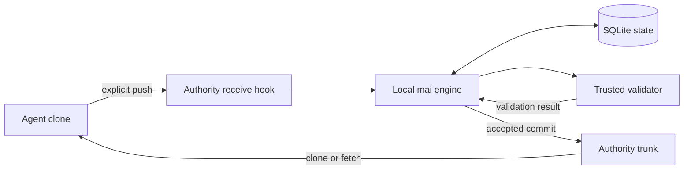

# mai architecture

mai coordinates local coding-agent changes through an authority repository and one local engine. Agents work in ordinary independent Git clones. The authority retains submitted commits, records lifecycle state in SQLite and publishes accepted changes to its trunk only after explicit integration and successful validation.

## Current flow

1. Initialize an authority from a project and configure trusted validation policy.
2. Create an independent workspace for each agent.
3. Explicitly enable bounded receive, then push a commit to register a generation. Receipt does not land the change.
4. Inspect the durable record and explicitly integrate the selected generation. Dependencies, policy, leases and validation are checked before publication.
5. Use the landed identity to continue local work in a new workspace when needed.

The engine is the sole writer for an authority. Git's first-parent trunk records accepted history; SQLite stores submission and validation state. Startup reconciliation relies on retained Git objects and consistent evidence and refuses contradictory or missing state. The authority and configured checks form a trusted-local boundary; mai does not sandbox repository commands.

Current manifests and leases use file units. Integration is explicitly selected and serial. Automatic scheduling, in-place synchronization, draft backup, semantic-object locking and priority policy are not delivered. See [current delivery and limits](release-status.md) and the relevant [CLI reference](cli.md).

## Project principles

Parallel contribution is the product goal; recovery supports that workflow. Accepted trunk is shared, so changes must pass the configured gate, and mai preserves rejected submissions for diagnosis and correction. mai does not choose conflicting intent or approve changes on an operator's behalf.
